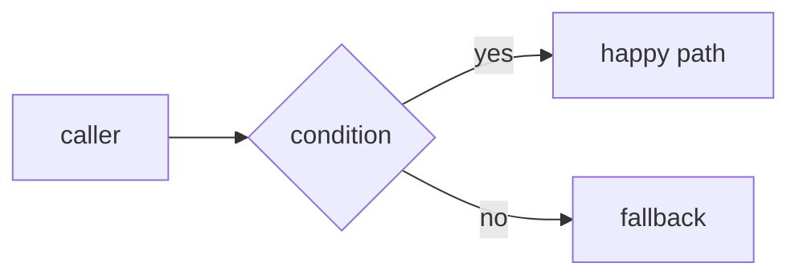
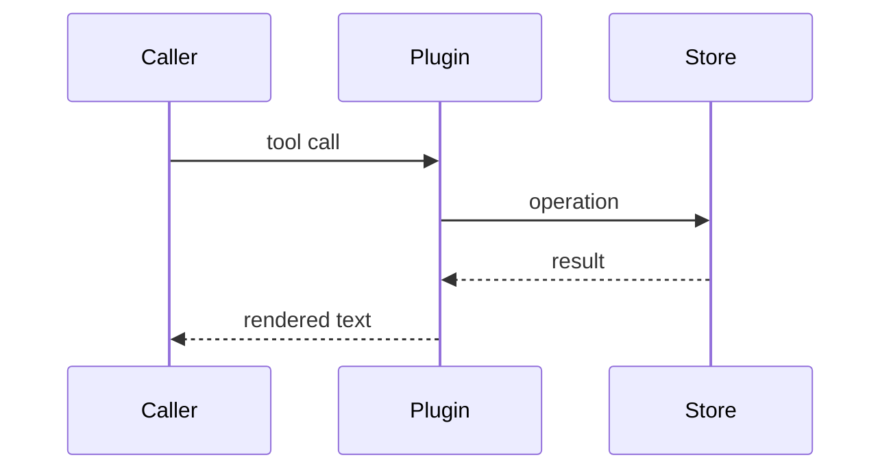

# Why

<!-- The problem, in one or two sentences, in behaviour-facing terms. -->

# What changed

-

<!-- Call out anything intentionally left unchanged, and name the commits. -->

# Visuals

<!-- Keep whichever diagram explains this change; delete the rest. Replace the placeholders. -->

<!-- State diagrams, an ER diagram, or a small before/after tree also work here. -->

# Validation and proof

| Check | Command | Result |
| --- | --- | --- |
| tests | `npm test` |  |
| manual |  |  |

<!-- Name the evidence: test names, counts, probe output. Say plainly what was NOT verified. -->

# UI proof

<!-- Screenshots or a short GIF of the visible result. Delete this section when the change has no UI. -->

| Before | After |
| --- | --- |
|  |  |

# Risk and rollback

-

---

- [ ] `npm test` passes
- [ ] the new check fails without this change
- [ ] no new dependency
- [ ] README or config updated when behaviour changed

<!-- Keep the description short. Delete what does not apply; a one-line visual beats a wall of prose. -->
